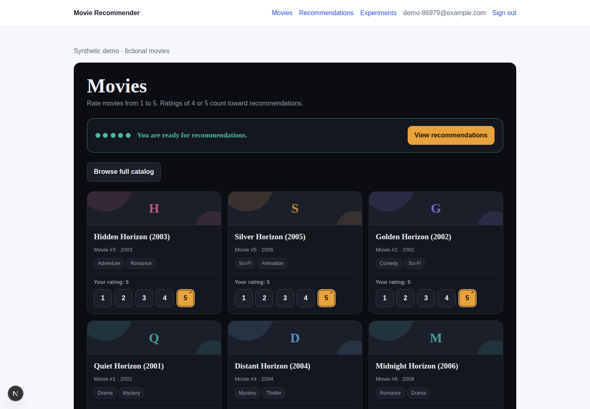
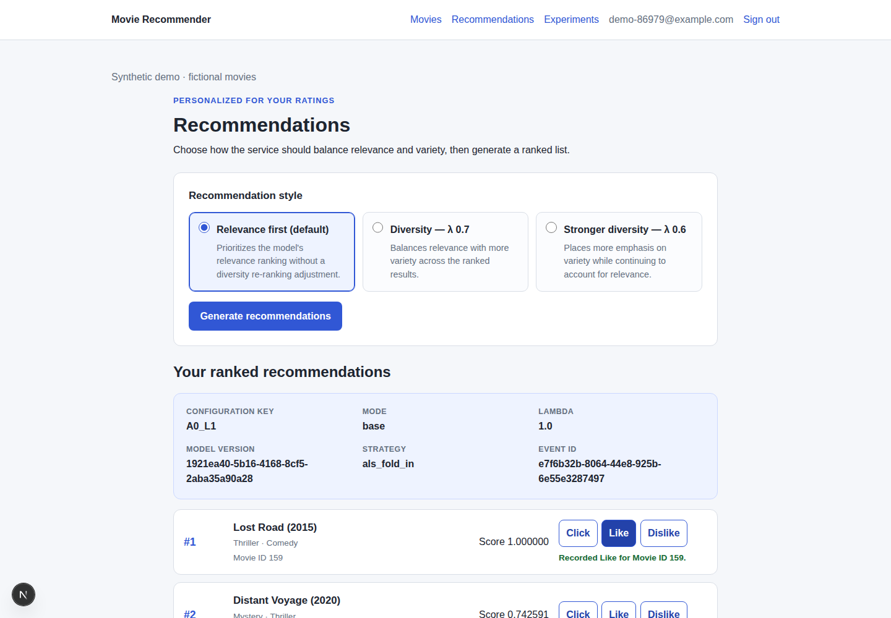
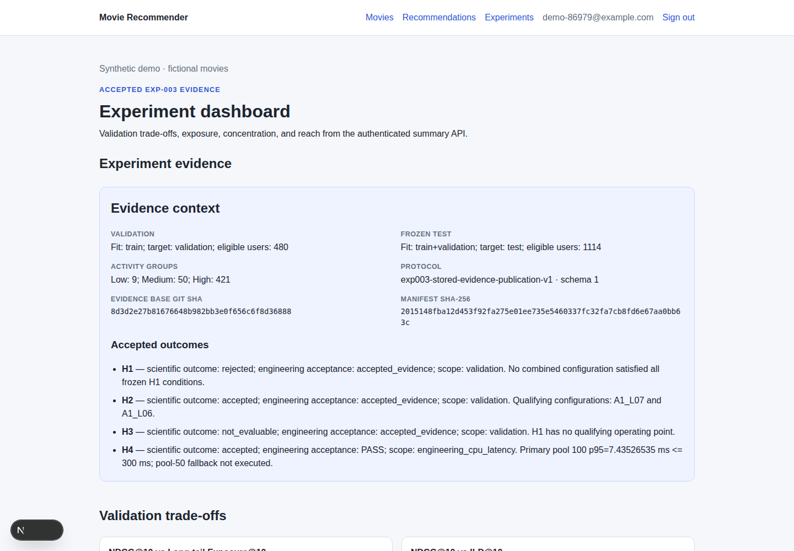
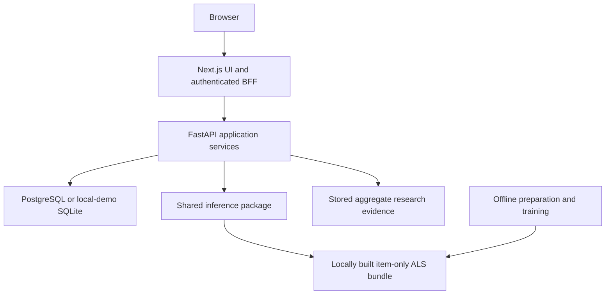

# Bias-Aware Movie Recommender

A full-stack undergraduate project exploring the trade-off between recommendation
accuracy, genre diversity and popularity exposure.

**Next.js · FastAPI · PostgreSQL · implicit ALS · deterministic reranking**

Rate films, generate personalized recommendations, compare three recommendation
styles and record feedback. The experiment dashboard presents the original
project's stored research results.



## Try it locally

Requirements: Python 3.11+, [uv](https://docs.astral.sh/uv/), Node.js 22 and npm.

```bash
git clone https://github.com/pArsA-Gh38/bias-aware-movie-recommender.git
cd bias-aware-movie-recommender
make demo
```

Open **http://127.0.0.1:3000**, register, and give 4 or 5 stars to at least
five films. The default demo uses **160 fictional films and synthetic interactions**.
It trains a small ALS model locally and uses persistent SQLite, so trying the
app needs no private model, dataset download or PostgreSQL installation.

The demo runs the real frontend, authenticated BFF, backend, shared inference
code and database repositories. Synthetic recommendations demonstrate the
software; they are separate from historical research evidence.

For a locally trained MovieLens model, review the dataset terms, then run
`make demo DATASET=movielens`. It downloads from GroupLens and fits positives
in the earliest 80% of globally ordered ratings. It does not rerun the original
held-out evaluation. See [setup](docs/SETUP.md).

## Features

- Registration/login, Argon2 password hashing and an HttpOnly session cookie.
- Searchable, filtered catalog and rating onboarding.
- New-user ALS fold-in with exclusion of every rated film.
- Relevance baseline and diversity styles at λ=0.7 and λ=0.6.
- Ranked results with server-confirmed metadata and applied configuration.
- Persisted recommendation events and owned-event feedback.
- Experiment dashboard with validation/test scope labels.
- Item-only local artifacts with checksums, geometry validation and safe NumPy loading.
- Unit, API, persistence and component tests, plus a browser workflow in CI.



## Research findings

The original MovieLens 1M study compared Popularity, ItemKNN and implicit ALS
under a global temporal 80/10/10 split. Ratings 4–5 were positives. Validation
used 480 eligible users; the frozen confirmatory test used 1,114.

| Stored test configuration | NDCG@10 | Genre ILD@10 | Long-tail exposure@10 |
| --- | ---: | ---: | ---: |
| ALS relevance baseline | 0.206247 | 0.736338 | 0.00008977 |
| Diversity, λ=0.7 | 0.204371 | 0.830367 | 0.00008977 |
| Diversity, λ=0.6 | 0.202224 | 0.858182 | 0.00008977 |

The observed benefit was **higher genre diversity with a small ranking-quality
cost**. These results did not establish improved long-tail exposure. H1 was
rejected, H2 accepted and H3 not evaluable. This is an MMR-style reranker,
without a protected-group fairness guarantee.

These are recorded results from the original undergraduate experiment. No new
statistical result is claimed for this release. Only aggregate tables/figures
are distributed. [Research and limitations](docs/RESEARCH.md) describe the boundaries.



## Architecture



| Path | Responsibility |
| --- | --- |
| `frontend/` | UI, BFF, component tests and browser workflow |
| `backend/` | API services, SQLAlchemy repositories and Alembic migrations |
| `packages/recommender_core/` | Scoring, fold-in, normalization, reranking and artifact integrity |
| `ml/` | Local model preparation, baseline models, metrics and temporal utilities |
| `reports/` | Aggregate tables, charts and original result summary |
| `scripts/` | Local runner, architecture and publication checks |

Training and evaluation stay outside the request path. Backend imports the
shared inference package, with no dependency on offline ML modules.
[Architecture](docs/ARCHITECTURE.md) explains the boundaries.

## Verification

```bash
make setup
make lint
make test
make frontend-check
cd frontend
npx playwright install chromium
npm run test:e2e
```

The persistence test checks real SQLite storage, ownership isolation, restart
behavior and foreign keys. CI also exercises PostgreSQL migrations and the
register → rate → recommend → feedback → dashboard browser workflow.

This is an academic/local prototype. Deployment, abuse protection, operational
monitoring and broader load testing remain future work.

## Documentation

[Setup](docs/SETUP.md) · [Architecture](docs/ARCHITECTURE.md) ·
[API](docs/API.md) · [Research](docs/RESEARCH.md) · [Testing](docs/TESTING.md) ·
[Contributing](CONTRIBUTING.md) · [Security](SECURITY.md)

## Author, license and attribution

**Parsa Ghadimi** — undergraduate Computer Engineering project.

Original code and authored documentation: [MIT](LICENSE).
MovieLens retains its separate [1M usage terms](https://files.grouplens.org/datasets/movielens/ml-1m-README.txt).
No MovieLens archive, source-user histories, private accounts or pretrained
research payloads are distributed here.

MovieLens citation: Harper & Konstan (2015), *The MovieLens Datasets: History and
Context*, [DOI: 10.1145/2827872](https://doi.org/10.1145/2827872).
Software citation metadata: [CITATION.cff](CITATION.cff).
